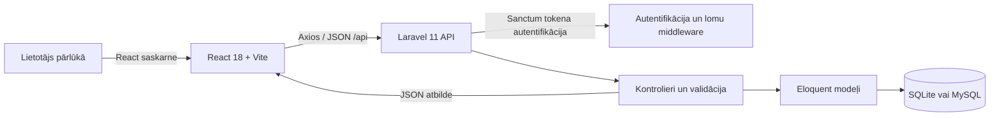
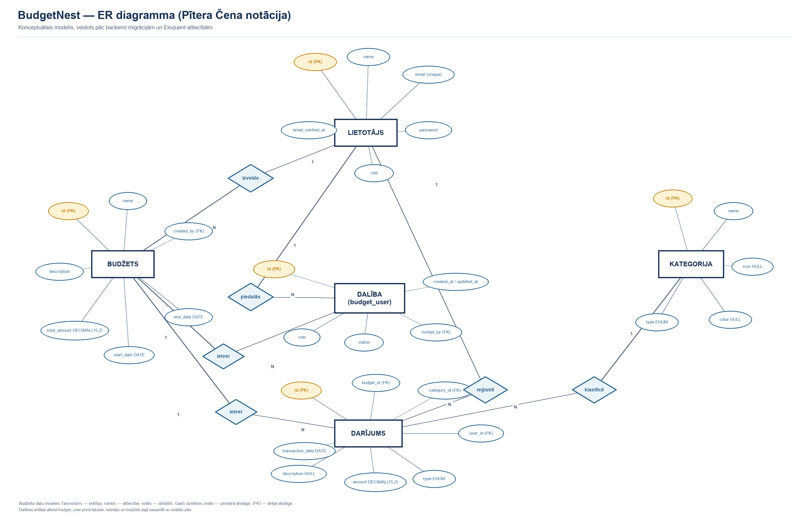

# BudgetNest sistēmas arhitektūra

## 1. Pārskats

BudgetNest veidots kā klienta–servera tīmekļa lietotne. Repozitorijā ir atsevišķs React/Vite frontend un Laravel API backend. Frontend izmanto HTTP pieprasījumus API, bet backend validē ievadi, piemēro biznesa noteikumus un lasa/raksta datus konfigurētajā relāciju datubāzē.

Šī ir loģiskā arhitektūra. Konkrētās izvietošanas, TLS, kešošanas un ražošanas infrastruktūras detaļas jāaizpilda atbilstoši izvēlētajai videi; tās netiek pieņemtas no lokālās izstrādes konfigurācijas.

## 2. Tehnoloģijas un robežas

| Slānis | Tehnoloģija | Atbildība |
|---|---|---|
| Lietotāja saskarne | React 18, Vite, Tailwind CSS, React Router | Ekrānu attēlošana, ievades formas, navigācija un API izsaukumi |
| HTTP klients | Axios | JSON pieprasījumi Laravel API; autentificētu pieprasījumu konfigurācija atrodas frontend API klientā |
| API | Laravel 11, PHP | Maršrutēšana, autentifikācija, ievades validācija, autorizācija un JSON atbildes |
| Autentifikācija | Laravel Sanctum | API tokenu izveide un `auth:sanctum` aizsargātie maršruti |
| Lomu pārbaude | Laravel `role:admin` middleware admin maršrutiem | Administratora galapunktu aizsardzība |
| Persistences slānis | Eloquent ORM | Modeļu un datubāzes tabulu attiecības |
| Datu bāze | SQLite vai MySQL | Lietotāji, budžeti, dalības, kategorijas un darījumi |

## 3. Galvenā pieprasījuma plūsma

1. Lietotājs veic darbību React saskarnē.
2. Frontend API modulis nosūta HTTP pieprasījumu uz `/api/...`; autentificētiem maršrutiem tiek pievienota autentifikācija.
3. Laravel maršrutētājs izvēlas kontrolieri. Aizsargātajiem maršrutiem vispirms tiek pārbaudīts Sanctum lietotājs; admin maršrutiem papildus tiek prasīta `admin` loma.
4. Kontrolieris validē pieprasījumu, piemēro piekļuves pārbaudes un izmanto Eloquent modeļus.
5. Backend atgriež JSON saturu un piemērotu HTTP statusu, piemēram, `200`, `201`, `401`, `403`, `404` vai `422`.
6. Frontend atjaunina ekrānu vai parāda kļūdas/veiksmes ziņojumu.

## 4. Backend moduļi

| Modulis | Atbildība | Galvenie resursi |
|---|---|---|
| Autentifikācija | Reģistrācija, pieteikšanās, izrakstīšanās, pašreizējais lietotājs | `AuthController`, Sanctum |
| Profils | Lietotāja informācijas/ paroles labošana un konta dzēšana | `ProfileController` |
| Budžeti | Budžetu saraksts, izveide, apskate, labošana, dzēšana, dalībnieku noņemšana un aiziešana | `BudgetController`, `Budget` |
| Uzaicinājumi | Uzaicinājuma izveide, gaidošo uzaicinājumu saraksts, pieņemšana un noraidīšana | `InvitationController`, `budget_user` |
| Darījumi | Darījumu CRUD, budžeta darījumi, filtri un lapošana | `TransactionController`, `Transaction` |
| Kategorijas | Kategoriju CRUD | `CategoryController`, `Category` |
| Administrēšana | Sistēmas kopsavilkums un lietotāju meklēšana/lapošana | `AdminController`, `role:admin` middleware |

## 5. Galvenais datu modelis

ER diagramma veidota Pītera Čena notācijā: taisnstūri apzīmē entītijas, rombi — attiecības, ovāli — atribūtus. Gaiši dzeltenie atribūti ir primārās atslēgas; `(FK)` norāda ārējo atslēgu. `DALĪBA` atbilst `budget_user` starptabulai, kuras loma un uzaicinājuma statuss ir dalības atribūti.

Rediģējamais diagrams.net avots: [`er-diagram.drawio`](er-diagram.drawio).

| Entītija | Galvenie dati | Attiecības |
|---|---|---|
| `users` | `id`, `name`, `email`, `password`, `role`, `email_verified_at` | Izveido budžetus; piedalās budžetos; reģistrē darījumus |
| `budgets` | `id`, `name`, `description`, `total_amount`, `start_date`, `end_date`, `created_by` | Pieder izveidotājam; ir dalībnieki un darījumi |
| `budget_user` | `budget_id`, `user_id`, `role`, `status`, `invited_by` | Daudzi-pret-daudziem saista lietotājus un budžetus; glabā dalības/uzaicinājuma stāvokli |
| `categories` | `id`, `name`, `icon`, `color`, `type` | Vienai kategorijai var būt daudzi darījumi |
| `transactions` | `id`, `budget_id`, `category_id`, `user_id`, `type`, `amount`, `description`, `transaction_date` | Pieder budžetam, kategorijai un izveidotājam |

Precīzie kolonnu tipi, indeksu definīcijas un ārējo atslēgu uzvedība jāņem no aktuālajām migrācijām; pilns lauku apraksts tiek uzturēts atsevišķā datubāzes dokumentā, kad tas ir sagatavots.

## 6. Autentifikācija un autorizācija

- Reģistrācija un pieteikšanās atgriež Sanctum personīgo piekļuves tokenu.
- Autentificētie API maršruti ietverti `auth:sanctum` middleware grupā.
- Administrēšanas maršruti papildus izmanto `role:admin`.
- Budžeta dalība glabā budžeta lomu un uzaicinājuma statusu.
- Atsevišķi kontrolieri pārbauda budžeta izveidotāju vai dalībnieku; autorizācijas pārbaudes nav automātiski garantētas visiem maršrutiem.

**Drošības nosacījums:** pirms publiskas izvietošanas jāveic maršrutu līmeņa autorizācijas pārskats, it īpaši darījumu apskate/izveide un kategoriju CRUD. Jāizveido testu matrica, kur katrai metodei pārbauda viesi, nesaistītu lietotāju un katru dalībnieka lomu.

## 7. Frontend organizācija

Frontend kods ir `frontend/src/`:

- `pages/` — maršrutu ekrāni;
- `components/` — atkārtoti lietojamās formas, saraksti, navigācija un diagrammas;
- `api/` — Axios izsaukumi backend resursiem;
- `context/` un `hooks/` — autentifikācijas stāvoklis un koplietojama klienta loģika;
- `routes/` — React Router maršruti un aizsargātās lapas.

Frontend route esamība pati par sevi nenozīmē, ka skats ir pabeigts. Piemēram, pirms laidiena jāpārbauda pieteikšanās/reģistrācijas, budžetu saraksta un administratora ekrānu faktiskā darbība.

## 8. Konfigurācija, palaišana un uzturēšana

Lokālās palaišanas prasības, vides failu sagatavošana, migrācijas un komandas aprakstītas [`LOCAL_SETUP.md`](../LOCAL_SETUP.md). API noklusētā lokālā adrese ir `http://localhost:8000/api`, frontend — `http://localhost:5173`.

Arhitektūras izmaiņām jāatjaunina šis dokuments, API specifikācija un datubāzes apraksts. Ražošanas vidē papildus jādokumentē domēni, HTTPS, atļautie frontend origin, tokenu glabāšana, rezerves kopijas, žurnāli un atjaunošanas procedūra.
