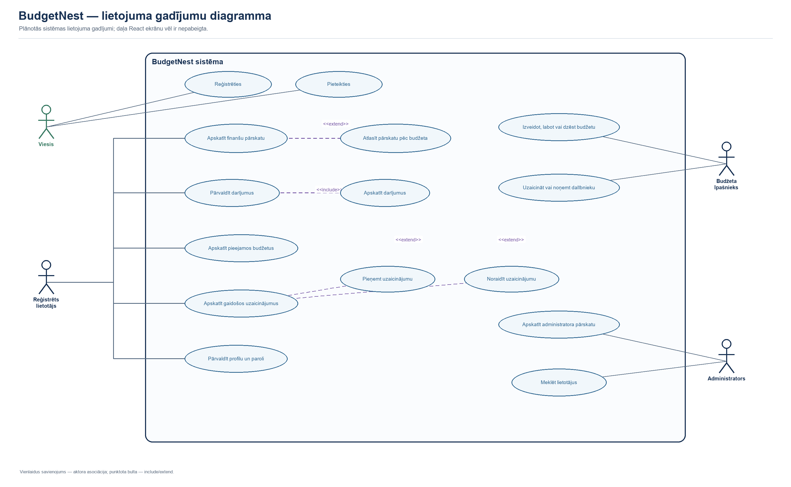

# BudgetNest prasību specifikācija

## 1. Mērķis un tvērums

BudgetNest ir tīmekļa lietotne personīgo un koplietojamo budžetu pārvaldībai. Sistēma ļauj reģistrētiem lietotājiem uzskaitīt ienākumus un izdevumus, sasaistīt tos ar budžetu un kategoriju, kā arī sadarboties, izmantojot uzaicinājumus un dalībnieku lomas.

Šis dokuments nosaka sistēmas prasības un to pārbaudes kritērijus. Funkciju statuss apraksta pašreizējo repozitorija stāvokli: API un React saskarnes gatavība var atšķirties.

## 2. Lietotāju lomas

| Loma | Apraksts |
|---|---|
| Viesis | Nav autentificēts; var piekļūt publiskajiem API reģistrācijas un pieteikšanās maršrutiem. |
| Reģistrēts lietotājs | Var izmantot autentificētās API darbības atbilstoši piekļuvei saviem budžetiem un datiem. |
| Budžeta īpašnieks | Budžeta izveidotājs un budžeta dalībnieku sarakstā piešķirtās `owner` lomas lietotājs; API atsevišķās darbībās pārbauda īpašnieka tiesības. |
| Budžeta redaktors | Koplietota budžeta dalībnieks ar `editor` lomu; paredzēts darījumu pārvaldībai. |
| Budžeta skatītājs | Koplietota budžeta dalībnieks ar `viewer` lomu; paredzēts datu apskatei. |
| Administrators | Konta loma `admin`; administratīvie API maršruti ir aizsargāti ar administratora lomas middleware. |

> **Piekļuves tiesību piezīme:** lomu nosaukumi un paredzētais lietojums ne vienmēr nozīmē, ka katrs kontrolieris pilnībā pārbauda attiecīgo lomu. Pirms laidiena atļauju pārbaudes jāizvērtē atsevišķi katram maršrutam; skatiet sadaļu [Nefunkcionālās prasības](#6-nefunkcionālās-prasības).

## 3. Lietojuma gadījumu diagramma

Diagramma attēlo viesi, reģistrētu lietotāju, budžeta īpašnieku un administratoru. Tajā redzami galvenie lietojuma gadījumi un UML `include`/`extend` attiecības. Tā apraksta plānoto sistēmas lietojumu; daļa React skatu vēl nav pabeigta.

Rediģējamais diagrams.net avots: [`use-case-diagram.drawio`](use-case-diagram.drawio).

## 4. Funkcionālās prasības

Statuss: **Ieviests API** — atrasts backend maršruts/kontrolieris; **Daļēji** — API vai saskarnes daļa ir, bet pilna lietotāja plūsma nav pieejama; **Jāpārbauda** — prasība jāpārbauda pret darbojošos lietotni un pieņemšanas kritērijiem.

| ID | Prasība | Pieņemšanas kritērijs | Statuss |
|---|---|---|---|
| FR-01 | Sistēma ļauj izveidot lietotāja kontu. | Pieņem vārdu, unikālu e-pastu un vismaz 8 rakstzīmju paroli ar apstiprinājumu; nederīgi un dublēti dati tiek noraidīti. | Ieviests API |
| FR-02 | Sistēma autentificē lietotāju un izsniedz piekļuves tokenu. | Pareizi akreditācijas dati dod lietotāja datus un tokenu; nepareizi dati tiek noraidīti. | Ieviests API |
| FR-03 | Autentificēts lietotājs var apskatīt savu konta informāciju un izrakstīties. | Lietotāja informācijai vajadzīgs derīgs tokens; izrakstīšanās anulē pašreizējo tokenu. | Ieviests API |
| FR-04 | Lietotājs var izveidot budžetu ar nosaukumu, summu un datumu intervālu. | Budžetam ir obligāts nosaukums, nenegatīva summa, sākuma un beigu datums; beigu datums ir vēlāk par sākuma datumu; izveidotājs tiek pievienots kā īpašnieks. | Ieviests API |
| FR-05 | Lietotājs var uzskaitīt savus budžetus un apskatīt budžeta detaļas. | Sarakstā ir lietotāja izveidotie un lietotājam piesaistītie budžeti; nepiederoša budžeta apskate tiek aizliegta. | Ieviests API |
| FR-06 | Budžeta tiesīgais īpašnieks var labot budžetu; izveidotājs var to dzēst. | Daļēja labošana pieņem tikai derīgus laukus; neatļauta labošana/dzēšana atgriež aizliegumu. | Ieviests API |
| FR-07 | Lietotājs var izveidot ienākuma vai izdevuma darījumu. | Darījumam ir budžets, kategorija, veids, summa vismaz 0,01 un datums; izveidotājs tiek saglabāts. | Ieviests API; atļauju pārbaude jāpārbauda |
| FR-08 | Lietotājs var apskatīt darījumus un filtrēt sarakstu. | Pieejami veida, kategorijas un datumu filtri; rezultāti ir sakārtoti pēc datuma dilstoši un sadalīti lapās. | Ieviests API |
| FR-09 | Lietotājs var labot vai dzēst darījumu, ja viņam ir atļauja. | API noraida lietotāju, kas nav darījuma veidotājs vai attiecīgā budžeta izveidotājs. | Ieviests API; pilna lomu politika jāpārbauda |
| FR-10 | Budžeta īpašnieks var uzaicināt reģistrētu lietotāju ar lomu. | E-pastam jāatbilst kontam; loma ir `owner`, `editor` vai `viewer`; uzaicinājumam ir gaidošs statuss. | Ieviests API |
| FR-11 | Uzaicinātais lietotājs var apskatīt, pieņemt vai noraidīt uzaicinājumu. | Sarakstā ir tikai lietotāja gaidošie uzaicinājumi; statusu var mainīt no `pending` uz `accepted` vai `declined`. | Ieviests API |
| FR-12 | Atļauts lietotājs var noņemt budžeta dalībnieku vai atstāt budžetu. | Budžeta izveidotāju nevar noņemt/atstāt ar parasto atstāšanas darbību; neesoša dalība tiek noraidīta. | Ieviests API |
| FR-13 | Lietotājs var apskatīt kategorijas; API ļauj izveidot, apskatīt, labot un dzēst kategorijas. | Kategorijai ir nosaukums un veids `income` vai `expense`; ikona un krāsa nav obligāta. | Ieviests API; piekļuves politika jāpārbauda |
| FR-14 | Lietotājs var labot profila datus un paroli. | E-pasts paliek unikāls; paroles maiņai vajadzīga pašreizējā parole, jaunā parole un apstiprinājums. | Ieviests API |
| FR-15 | Lietotājs var dzēst savu kontu, apstiprinot paroli. | Nepareiza parole noraida pieprasījumu; pareiza parole dzēš kontu. | Ieviests API; saskarnē darbība var nebūt pieejama |
| FR-16 | Administrators var apskatīt kopsavilkuma statistiku un lietotāju sarakstu. | Nepie administratora kontam abi maršruti ir aizliegti; saraksts tiek sadalīts lapās un atbalsta meklēšanas parametru. | Ieviests API; React administratora skats jāpārbauda |
| FR-17 | React saskarne ļauj lietotājam izmantot konta, budžeta un darījumu darbības. | Lietotāja plūsmas izsauc atbilstošos API maršrutus un parāda kļūdu/veiksmes stāvokļus. | Daļēji; pārbaudīt aktuālo saskarni |
| FR-18 | Sākuma panelis apkopo budžeta un darījumu informāciju. | Var atlasīt budžetu, redzēt kopsummas un darījumu/diagrammu apkopojumu, ja API sniedz datus. | Daļēji; jāpārbauda ar darbojošos lietotni |

## 5. Datu validācijas pamatnoteikumi

- Lietotāja vārds: obligāts teksts, ne vairāk kā 255 rakstzīmes.
- E-pasts: obligāts, derīgs un unikāls.
- Parole: vismaz 8 rakstzīmes; reģistrējoties un mainot paroli nepieciešams apstiprinājums.
- Budžeta summa: skaitlis, vismaz 0; precīzā naudas precizitāte jāpārbauda DB shēmā.
- Budžeta beigu datums: obligāts un vēlāk par sākuma datumu.
- Darījuma veids: `income` vai `expense`; summa vismaz 0,01.
- Kategorijas veids: `income` vai `expense`.
- Uzaicinājuma loma: `owner`, `editor` vai `viewer`.

## 6. Nefunkcionālās prasības

| ID | Prasība | Pārbaudes veids |
|---|---|---|
| NFR-01 | Autentificētiem API pieprasījumiem jāpieprasa derīgs Sanctum tokens; publiskai piekļuvei jābūt tikai skaidri paredzētiem maršrutiem. | API testi: bez tokena, nederīgs tokens un derīgs tokens |
| NFR-02 | Lietotājs nedrīkst apskatīt vai mainīt cita lietotāja datus bez atbilstošas piekļuves. | Lomu/piekļuves integrācijas testi katram maršrutam un HTTP metodei |
| NFR-03 | Ievade tiek validēta serverī; atbildēs tiek atgriezti saprotami HTTP statusi un validācijas kļūdas. | Pozitīvie, negatīvie un robežgadījumu API testi |
| NFR-04 | Paroles tiek glabātas kā jaucējvērtības, nevis vienkāršā tekstā. | Koda un datubāzes pārbaude; reģistrācijas tests |
| NFR-05 | Garie saraksti tiek lapoti, lai ierobežotu vienā atbildē atgriezto ierakstu apjomu. | Pārbaudīt `data`, `links`/`meta` lapošanas struktūru |
| NFR-06 | Frontend un backend ir palaižami lokāli ar projekta iestatīšanas instrukciju. | Svaigas vides uzstādīšanas un palaišanas pārbaude |
| NFR-07 | Saskarne atspoguļo datu ielādes, tukša rezultāta, veiksmes un kļūdas stāvokļus. | Manuālie UI testi un pieejamības pārbaude |
| NFR-08 | Dokumentācija un testu rezultāti atbilst faktiskajai versijai; neizpildīti testi netiek uzrādīti kā izturēti. | Dokumentu pārskats pirms laidiena |

**Drošības pārbaudes obligātā joma:** pirms produkcijas lietošanas jāpārbauda piekļuves kontrole visos budžeta, darījumu un kategoriju maršrutos. Pašreizējā kodā dažu darbību lomu/īpašumtiesību pārbaudes var nebūt vienādas starp maršrutiem; šo dokumentu nedrīkst uzskatīt par drošības atbilstības apliecinājumu.

## 7. Ārpus pašreizējā tvēruma vai nepabeigts

- React `/login`, `/register`, `/budgets` un `/admin` skatu gatavība jāpārbauda; daļa no apskatītajiem komponentiem ir tikai sagataves.
- Nav dokumentēta vai garantēta automātiska bankas kontu piesaiste, maksājumu apstrāde, valūtas konvertēšana vai finanšu konsultācijas.
- Diagrammu un analītikas korektums jāpārbauda pret definētu datu periodu un aprēķina noteikumiem.
- Lomu tiesību precīzā matrica jāapstiprina komandai un jāpārbauda ar automatizētiem testiem.

## 8. Prasību pārvaldība

Katram Trello uzdevumam un testam jānorāda saistītās prasības ID. Prasības izmaiņu gadījumā atjaunojiet pieņemšanas kritērijus, API dokumentāciju, testus un lietotāja instrukciju. Atbildīgās personas un apstiprināšanas datumu aizpilda projekta komanda.

| Versija | Datums | Izmaiņas | Apstiprināja |
|---|---|---|---|
| 1.0 | 2026-10-26 | Sākotnējā specifikācija, balstīta repozitorijā apskatītajos maršrutos un moduļos. | Jāaizpilda |
